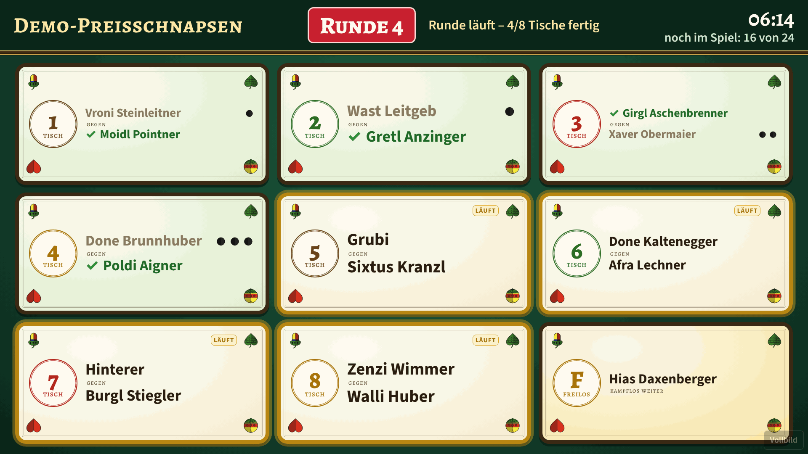
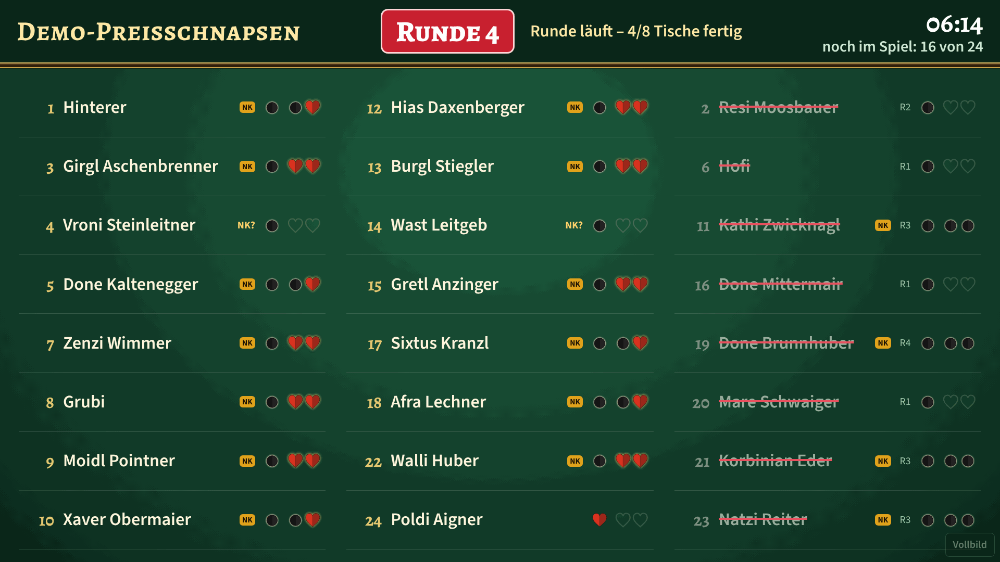
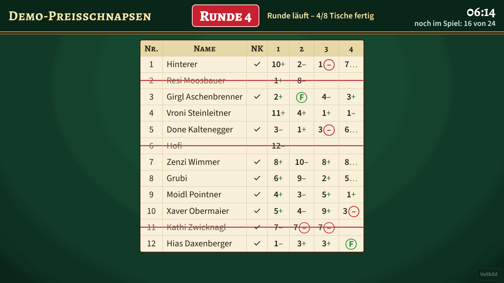
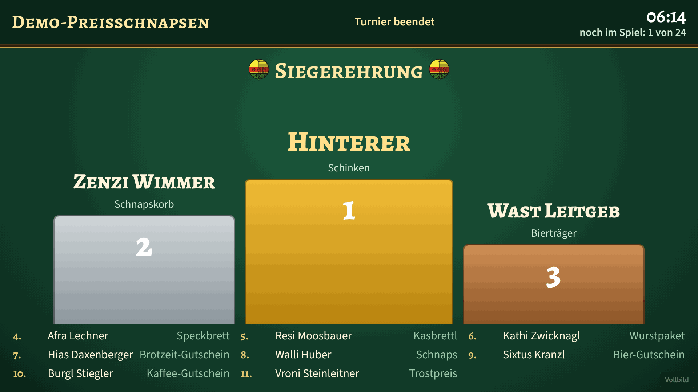
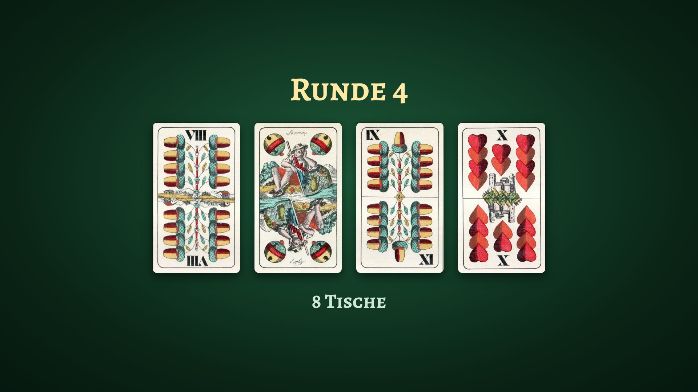
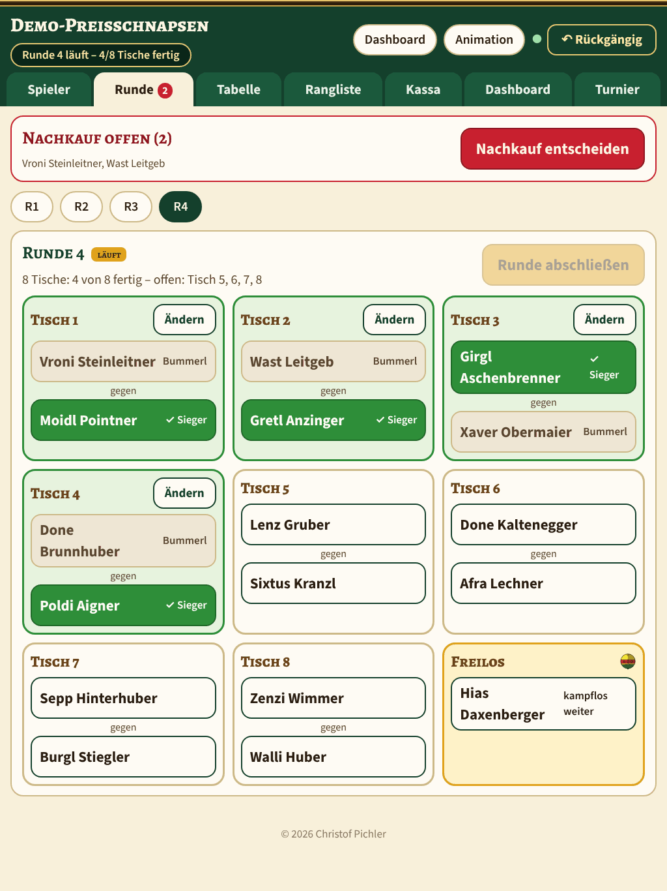
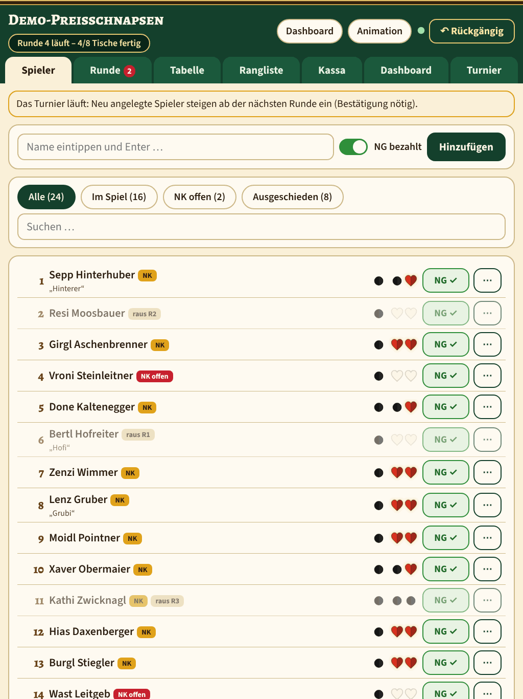

# Preisschnapsen

A web app for running a **Schnapsen** card tournament (Preisschnapsen) with German-suited cards (Eichel, Laub, Herz, Schelln). It replaces the paper list: players are registered, every round is drawn, results are entered, and a live dashboard shows tables, lives, standings and the award ceremony.

Schnapsen is a two-player trick-taking card game. A few German terms are used throughout the app and this document:

* **Nenngeld (NG)**: the entry fee. It covers one life.
* **Bummerl**: a lost game. Every lost game costs one life.
* **Nachkauf (NK)**: a one-time rebuy, possible only right after the first bummerl. It adds two more lives.
* **Freilos**: a bye. With an odd number of players one player advances without playing and loses no life.
* **Platzierungsspiel**: a placement game that orders players who were eliminated in the same round.

The user interface is in German. The code, the command line and this documentation are in English.

## Features

* Admin area for touch devices and desktops: quick player entry, automatic draw (**Auto**) or manual draw from a real pot of paper tickets (**Manuell**), one-tap result entry, rebuy dialog, corrections of past rounds with warnings, placement games, cash overview, tournament reset and removal of all players, undo, CSV export, print view (A4 landscape), JSON backup and import, and a button that replays the draw animation on all dashboards.
* Live dashboard for a large display: draw animation that deals four random cards from a pool of historic card scans (face down, then flipped), tables of the current round as playing cards, players with remaining lives as red hearts and bummerls as black dots, a matrix like the paper list, ranking, optional cash view and award ceremony. Views rotate automatically or can be pinned.
* Live updates via Server-Sent Events with polling fallback and automatic reconnect. Several admin devices stay in sync.
* Derived state: lives, status and ranking are never stored as counters but always recomputed from results and rebuys, so corrections of old rounds stay consistent.
* Idempotent write requests (`X-Request-Id`), serialised writes, SQLite in WAL mode, automatic database backup after every closed round, 50 undo steps.
* Works fully offline: no CDNs, fonts and icons ship with the app.
* Minimal dependencies: `fastapi` and `uvicorn`. Passwords are stored as scrypt hashes (standard library).

## Screenshots

| Dashboard: tables | Dashboard: players |
|---|---|
|  |  |

| Dashboard: matrix | Dashboard: award ceremony |
|---|---|
|  |  |

| Dashboard: draw animation |
|---|
|  |

| Admin: round | Admin: players |
|---|---|
|  |  |

The screenshots show the demo tournament (`schnapsen demo`, fictional names).

## Tournament rules as implemented

1. Every participant pays the entry fee (default 20 EUR, configurable). It covers the first bummerl.
2. Without a rebuy a player is eliminated with the first bummerl. With a rebuy (default 10 EUR, configurable, once per player, only directly after the first bummerl) a player may lose twice more and is eliminated with the third bummerl.
3. Each table has two players and exactly one winner. The loser gets a bummerl.
4. All players still in the game are drawn anew for every round, winners and surviving losers alike. A new round can only be drawn when the previous round is closed and all rebuy decisions are made.
5. Draw: tables `1..N` (N = active players / 2, rounded down). Every table number goes into the pot twice, one ticket per player. With an odd number of players one additional bye ticket (`F`) is added. Example: 19 players give tickets 1-9 twice plus one `F`.
6. The automatic draw (**Auto**) uses `secrets.SystemRandom`. By default it avoids repeating the pairing of the previous round and giving the same player two byes in a row (up to 300 shuffles, the variant with the fewest violations wins). Both options can be switched off. In manual mode (**Manuell**) the admin enters the ticket each player drew; the app validates that every number appears exactly twice and `F` exactly once (odd count) or never (even count).
7. A draw is a draft until it is published. Only published rounds appear on the dashboard.
8. The tournament ends when only one player is left after a round and all rebuy decisions are made. In the final the loser keeps playing as long as he or she has lives left.
9. Ranking: players eliminated later rank higher. Players eliminated in the same round share a place range. Inside the prize ranks the order is decided by a placement game: for two players the admin taps the winner, for larger groups the order is set with arrow buttons. The audit log records e.g. "Platzierungsspiel Pl. 4/5: A schlägt B".
10. A player can be marked as withdrawn. A running pairing without result is won by the opponent; the player is eliminated in the current round (between rounds: in the last closed round).
11. Players registered after the start join from the next round, after explicit confirmation. Players can only be deleted while they appear in no pairing.
12. Results of closed rounds can be corrected after confirmation. If a correction makes a later round inconsistent (for example a player would have been eliminated earlier), the admin area shows warnings; data is never changed silently.
13. The tournament ends automatically; it can be finished manually and reopened by reopening the last round.

## Requirements

* Python 3.11 or newer
* `fastapi` and `uvicorn` (see `requirements.txt`)
* For the installer: Debian 12 or Ubuntu 24.04 (also in an LXC container), root access, internet access during installation only. At runtime no internet access is needed.

## Installation (Debian / Ubuntu, also LXC)

```bash
git clone https://github.com/christofpichler/preisschnapsen.git && cd preisschnapsen && sudo ./install.sh
```

`install.sh` is idempotent and

* installs `python3` and `python3-venv` via apt,
* copies the app to `/opt/schnapsen` and creates a virtualenv there,
* creates the system user `schnapsen`, `/var/lib/schnapsen` (with `backups/`) and `/etc/schnapsen/schnapsen.env` (mode 640, `root:schnapsen`),
* asks for user name and password of the `admin` account (default user name `admin`) and the `user` account (default `user`) on the first run,
* installs and starts the systemd service `schnapsen` (enabled at boot, `Restart=always`, hardened; in containers without sandbox support it falls back to a drop-in without sandbox options),
* installs the helper commands `schnapsen-passwd` and `schnapsen`,
* prints the URLs.

The service listens on port 8080. Status and logs: `systemctl status schnapsen`, `journalctl -u schnapsen -f`.

Try it with sample data: `schnapsen demo`.

For a non-interactive installation set `INSTALL_ADMIN_PASSWORD` and `INSTALL_DASHBOARD_PASSWORD`.

## Update

```bash
git pull && sudo ./install.sh
```

Data, configuration and passwords are kept; the service is restarted. Existing `schnapsen.env` files stay valid.

## Configuration

`/etc/schnapsen/schnapsen.env` (template: `.env.example`; the path can be changed with `SCHNAPSEN_CONFIG`). Every value can also be set as a real environment variable, which takes precedence over the file. The server refuses to start when a password hash is missing.

| Variable | Default | Meaning |
|---|---|---|
| `SCHNAPSEN_HOST` | `0.0.0.0` | listen address |
| `SCHNAPSEN_PORT` | `8080` | listen port |
| `SCHNAPSEN_DB` | `/var/lib/schnapsen/schnapsen.db` | SQLite database |
| `SCHNAPSEN_BACKUP_DIR` | `<database directory>/backups` | target of the automatic backups |
| `SCHNAPSEN_ADMIN_USER` | `admin` | user name of the admin account |
| `SCHNAPSEN_ADMIN_HASH` | none (required) | scrypt hash of the admin password |
| `SCHNAPSEN_DASHBOARD_USER` | `user` | user name of the `user` account |
| `SCHNAPSEN_DASHBOARD_HASH` | none (required) | scrypt hash of the `user` password |

Tournament settings (amounts, prize ranks, prizes, available tables, draw options, dashboard options) are edited in the admin area, not in the file. If the backup directory is outside `/var/lib/schnapsen`, add it to `ReadWritePaths=` in `deploy/schnapsen.service`.

## Accounts and roles

The whole site (except `/static/`) uses one HTTP Basic Auth realm, `Preisschnapsen`, so the browser asks for credentials only once, whichever URL is opened first. `/` redirects to `/dashboard/` after login.

| Role | Variables | Access |
|---|---|---|
| `admin` | `SCHNAPSEN_ADMIN_*` | dashboard and admin area |
| `user` | `SCHNAPSEN_DASHBOARD_*` | dashboard only |

* A `user` requesting `/admin/` or `/admin/api/...` gets `403` (not `401`, which would cause a login loop).
* The dashboard header shows an "Admin-Panel" button only to admins; the admin area links back to the dashboard.
* The role is reported as `role` in the state API.
* Change a password: `schnapsen-passwd admin` or `schnapsen-passwd user` (alias `dashboard`). The hash is written to the env file and the service is restarted. Change the user name too with `schnapsen-passwd user --user NAME`.
* Basic Auth has no logout. The browser keeps the credentials until it is quit; to switch accounts, use a private window, delete the saved credentials, or open `https://logout:x@<host>/` once to make the browser ask again.
* Successful authentications are cached in memory for five minutes (key: SHA-256 of the `Authorization` header).
* Write requests require `Content-Type: application/json` and the header `X-Schnapsen: 1`; `Origin`/`Referer` are checked against the host when present.
* The `user` role gets a reduced view: no notes, audit log or payment status; cash totals only if enabled in the admin area.

## Backup and restore

* Automatic: after every closed round a copy of the database is written to the backup directory (`schnapsen-YYYYMMDD-HHMMSS-roundN.db`; the newest 300 are kept).
* Manual: `schnapsen backup` prints the path of the new file.
* JSON: the admin area exports the active tournament as JSON. Importing creates a new, inactive tournament with new IDs; activate it in the archive list.
* Restore from a database file:

  ```bash
  sudo systemctl stop schnapsen
  sudo cp /var/lib/schnapsen/backups/schnapsen-XXXX.db /var/lib/schnapsen/schnapsen.db
  sudo rm -f /var/lib/schnapsen/schnapsen.db-wal /var/lib/schnapsen/schnapsen.db-shm
  sudo chown schnapsen:schnapsen /var/lib/schnapsen/schnapsen.db
  sudo systemctl start schnapsen
  ```

## HTTPS via reverse proxy

Basic Auth over plain HTTP sends credentials unencrypted. That can be acceptable in a trusted local network. If the app is reachable from the internet, put a reverse proxy with HTTPS in front of it and set `SCHNAPSEN_HOST=127.0.0.1`. A Caddy example is in `deploy/Caddyfile.example`:

```caddyfile
schnapsen.example.org {
	encode gzip
	reverse_proxy 127.0.0.1:8080 {
		flush_interval -1
	}
}
```

`flush_interval -1` forwards Server-Sent Events immediately. For a LAN without a public name use `tls internal`.

## Command line

```bash
schnapsen demo               # create and activate a demo tournament (24 fictional players, 3 rounds played)
schnapsen demo --finish      # same, played to the end (to see the award ceremony)
schnapsen simulate           # simulate complete tournaments (2, 3, 19, 24, 40 players) and check invariants
schnapsen simulate --players 24 --seeds 20 -v
schnapsen backup             # create a database backup
schnapsen hash               # print a password hash
schnapsen-passwd admin|user  # set a password
```

Without installation use `python -m app.cli ...`.

## Development

```bash
python3 -m venv .venv && . .venv/bin/activate
pip install -r requirements.txt pytest httpx
python -m pytest                 # unit, API and simulation tests
python -m app.cli simulate       # simulated tournaments with invariant checks
python tools/make_suits.py       # regenerate the sprite (suit symbols and the cards from tools/make_cards.py)
```

Run a development server:

```bash
python -m app.cli --config ./dev.env passwd admin
python -m app.cli --config ./dev.env passwd user
SCHNAPSEN_CONFIG=./dev.env SCHNAPSEN_DB=./dev.db python -m app
```

The application must run as a single process: the write lock, the SSE version counter and the idempotency cache (10 minutes) live in memory.

## Project structure

```
app/engine.py      rules engine: raw data -> complete derived state (pure function)
app/draw.py        ticket-pot draw, soft rules, manual assignment validation
app/service.py     SQLite access, write operations, undo snapshots, export/import, backups
app/main.py        FastAPI routes, auth, CSRF checks, idempotency, SSE
app/auth.py        scrypt hashes, Basic Auth, credential cache
app/config.py      env file and environment variables
app/exports.py     CSV export and print view
app/cli.py         command line interface
app/simtools.py    demo and simulation helpers
app/static/        HTML, CSS, JS, fonts, SVG
tools/             make_suits.py (sprite generator), make_cards.py (drawn fallback cards and card back), prepare_cards.py (card scans)
tests/             pytest suite
deploy/            systemd unit, Caddyfile example
docs/screenshots/  images used by this README
install.sh         installer / updater
```

## Known limitations

* One account per role; no user management beyond Basic Auth, no logout.
* Exactly one tournament is active at a time; others are kept in the archive.
* Undo covers game actions only, not dashboard settings, creating, activating or deleting tournaments, and imports.
* JSON import does not carry the audit log or undo history.
* Payments are tracked as paid/unpaid flags; the cash view is an aid, not bookkeeping.
* The print view targets A4 landscape; with more than 17 rounds the columns get narrow.
* Single process only (see Development).
* The user interface is German only.

## Card images

When a draw is published (or the admin presses "Animation"), every dashboard plays a short animation that deals four random cards from `app/static/img/cards/` face down and flips them; afterwards the tables are shown. The animation can be switched off in the admin area. The bundled images are scans of a late 19th century Doppeldeutsche (Tell pattern) pack by Ferd. Piatnik & Söhne, Vienna, with the Austro-Hungarian card tax stamp; the artwork is in the public domain. Scans courtesy of the playing card collection at [endebrock.de](http://www.endebrock.de/).

To add cards, put scans through `tools/prepare_cards.py` (neutralises the paper tone, crops strips of several cards with `--strip N --names ...`, scales and compresses). Every JPEG/PNG/WebP in the folder is picked up at server start. Without images the animation uses the drawn cards from `tools/make_cards.py`.

## License

Released under the [MIT License](LICENSE). Copyright (c) 2026 Christof Pichler.

The fonts in `app/static/fonts` (Alegreya SC and Source Sans 3) are licensed under the SIL Open Font License; the license texts are in the same directory.
